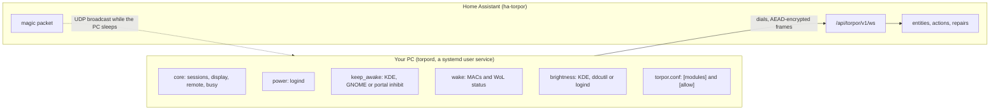

# How it works

The README covers using Torpor. This page is the picture behind it: who dials whom, what pairing
does, where the settings live, and what each module does. [protocol.md](protocol.md) has the wire
format, and [security.md](security.md) the threat model.

- **The PC dials Home Assistant** at `/api/torpor/v1/ws`, on Home Assistant's own port. Nothing
  listens on the PC.
- **Pairing** turns a one-time code from Home Assistant into a key both sides keep. Every connection
  then runs a handshake that proves the key both ways and makes fresh encryption keys, so recorded
  traffic stays private even if the key leaks later. Every message is encrypted, and the PC holds no
  Home Assistant token.
- **Facts and ceilings live on the PC; behavior lives in Home Assistant.** `torpor.conf` says which
  modules run and what Home Assistant may trigger. Home Assistant's options pick the features, the
  brightness curve and the light sensor, and can never go beyond the PC's ceiling.
- **Before the PC sleeps or shuts down**, the agent holds a logind delay inhibitor, tells Home
  Assistant, waits up to 2 seconds for the acknowledgement, then lets go.
- **Wake** is Home Assistant's job: it sends the magic packet to the MAC the agent reported and
  waits for the agent to connect again.

## Modules

| Module | What it does | Read |
|---|---|---|
| `core` | The state, sessions, display, remote and busy reasons, the going-down goodbye | [core](modules/core.md) |
| `power` | Lock, suspend, hibernate, power off, restart through logind | [power](modules/power.md) |
| `keep_awake` | The keep-awake switch, leases and busy processes | [keep-awake](modules/keep-awake.md) |
| `wake` | MAC addresses and Wake-on-LAN status | [wake](modules/wake.md), [wake-on-lan](wake-on-lan.md) |
| `brightness` | Brightness per display, automatic brightness from a lux sensor, a curve per monitor mode, a boost while a game runs | [brightness](modules/brightness.md) |

What each desktop gets is in [install.md](install.md#desktops).

## Versions

Agent 0.1 speaks protocol 1. The integration says which protocol versions it speaks in its own
[how-it-works page](https://github.com/ovflowd/ha-torpor/blob/main/docs/how-it-works.md#versions).
