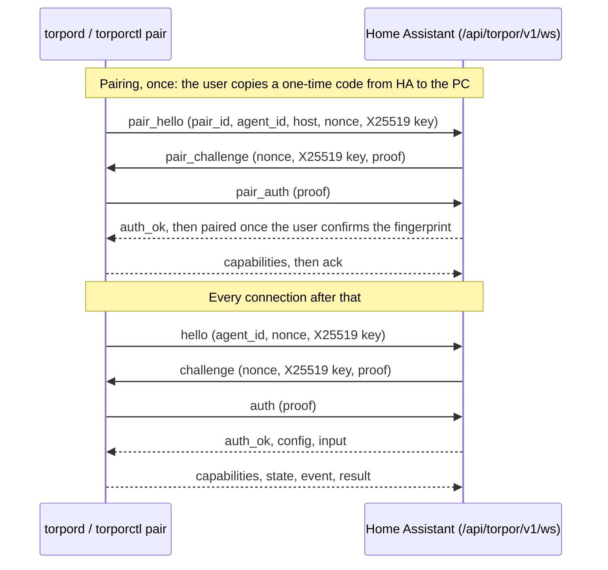

# Torpor protocol, version 1

How the Torpor agent on a PC (`torpord`) and the Torpor integration in Home Assistant talk to each
other. The PC dials Home Assistant, proves it holds a key the two sides agreed on when you paired
them, and then every message travels encrypted and authenticated, over `ws://` as well as `wss://`.

The reference implementation is [`torpor/protocol.py`](../torpor/protocol.py). The integration
ships the same file, byte for byte, as `custom_components/torpor/protocol.py`. Both repos carry the
same test vectors in `tests/vectors/` and the same `tests/vectors/SHA256SUMS`, which pins the file,
its test and the vectors, so a copy that drifts fails the tests. When this page and the code
disagree, the vectors decide, and one of the two gets fixed.

Words in this page:

| Word | Meaning |
|---|---|
| agent, PC | `torpord`, the user service on the Linux PC |
| HA | the Torpor integration inside Home Assistant |
| peer | either side |
| entry | the Home Assistant config entry for one paired PC |

## Overview



Solid arrows are WebSocket text messages in clear. Dashed arrows are binary messages, each one an
encrypted frame.

- **Endpoint.** `GET /api/torpor/v1/ws` on Home Assistant's own HTTP server, upgraded to a
  WebSocket. The integration registers it as a view with `requires_auth = False` and does its own
  authentication, as Home Assistant's WebSocket API does (see [security.md](security.md)).
- **Who dials.** Always the PC. Home Assistant never opens a connection to the PC, and the PC
  listens on no port.
- **One connection per PC.** When a second connection for the same `agent_id` authenticates, Home
  Assistant closes the older one with 4409.
- **Two handshakes.** *Pairing* runs once, with a one-time code, and leaves both sides holding the
  same 32-byte pairing key. The *session* handshake runs on every connection and uses that key.
  Both use a fresh X25519 exchange, so a later leak of the pairing key does not expose traffic
  recorded earlier.

## Building blocks

| Notation | Meaning |
|---|---|
| `lp(a, b, …)` | Each part as a 4-byte big-endian length followed by its bytes, concatenated. Text is UTF-8 |
| `H(m)` | SHA-256 |
| `HMAC(k, m)` | HMAC-SHA-256 |
| `Extract(salt, ikm)`, `Expand(prk, info, n)` | HKDF with SHA-256, RFC 5869 |
| `X25519(private, public)` | RFC 7748. An all-zero result is refused (4400) |
| AEAD | ChaCha20-Poly1305, RFC 8439: 32-byte key, 12-byte nonce, 16-byte tag |
| `b64(x)` | Base64, RFC 4648 section 4, with padding. Receivers decode strictly and check the length |
| `"…" ‖ x` | The ASCII label followed by the bytes of `x` |

JSON is UTF-8 and always an object with a string `type`. `NaN`, `Infinity` and numbers that
overflow to infinity are refused. Senders write compact JSON; receivers never depend on field order
or spacing. Receivers ignore fields they don't know.

PC side: Python's `cryptography` package from the distro (`python3-cryptography`, 41 or newer).
Home Assistant side: the `cryptography` that Home Assistant itself pins (50.0.2 in 2026.11), so the
integration adds no requirement.

## Identities and secrets

| Name | Size | Made by | Kept where | On the network |
|---|---|---|---|---|
| `agent_id` | UUID text | The PC, from `/etc/machine-id` | Both sides; it is the entry's unique ID | In clear, in every `hello` |
| Pairing code `C` | 20 bytes | HA, with `secrets.token_bytes` | The pending config flow, 15 minutes at most | Once, to your browser (see [security.md](security.md)) |
| Pairing key `K` | 32 bytes | Derived by both sides while pairing | PC: `~/.config/torpor/key`, mode 0600. HA: the entry's data | Never |
| Nonces, X25519 key pairs | 32 bytes each | Each side, per connection | Memory | Only the public halves |
| Session keys | 4 × 32 bytes | Derived per connection | Memory | Never |

### `agent_id`

The application-specific machine ID that `sd_id128_get_machine_app_specific()` computes, which
`machine-id(5)` asks applications to use instead of the raw ID:

1. `m` = the 16 bytes of `/etc/machine-id` (32 hex digits).
2. `d` = the first 16 bytes of `HMAC(m, APP_ID)`, where `APP_ID` is the 16 bytes of the UUID
   `570fe902-bf3b-439f-b2eb-3dfaf29fb91b`.
3. Set the UUID version and variant bits: `d[6] = d[6] & 0x0f | 0x40` and `d[8] = d[8] & 0x3f | 0x80`.
4. Write `d` as a lowercase UUID with hyphens.

`systemd-id128 machine-id --uuid --app-specific=570fe902bf3b439fb2eb3dfaf29fb91b` prints the same
value; the vectors were checked against it with systemd 262. A reinstalled OS gets a new
`machine-id`, so it needs a new pairing, which is intended.

### The pairing code

HA makes 20 random bytes and shows them as `trp1-` followed by 32 lowercase base32 characters
(RFC 4648 alphabet, no padding) in groups of four:

```text
trp1-mp5s-7ncd-o7w2-vtka-jvzm-zay3-hmxu-zzv4
```

(Every code, key and address in this page is synthetic. This is the code in
`tests/vectors/primitives.json`; its pairing in `pairing.json` shows the fingerprint `TGVU-FESI`.)

When reading a code, the PC drops spaces and hyphens, ignores case, and accepts it with or without
the `trp1` prefix. Anything that isn't exactly 32 base32 characters after that is refused before
any network traffic, so a typo fails at once.

`code_key = Extract("torpor/1 pairing code", C)`

`pair_id = b64(HMAC(code_key, "torpor/1 pair id")[0:8])`

The `pair_id` lets HA find the pending pairing without trying every code. It says nothing useful
about `C`.

## Pairing

Pairing turns the one-time code into the pairing key `K`. The code authenticates an X25519
exchange; it is not the key. So someone who saw the code but not the exchange learns nothing about
`K`, and the code is worthless once the pairing ends.

1. **In Home Assistant** the user adds the Torpor integration. The config flow makes `C`, registers
   `pair_id → (flow, C)`, and shows the code and the command `torporctl pair --url <HA URL>`. It
   waits up to 15 minutes (`PAIRING_TIMEOUT_S`).
2. **On the PC**, `torporctl pair` reads the code with hidden input (or from stdin), checks its
   form, and connects.
3. PC → HA, text:

   ```json
   {"type":"pair_hello","proto":1,"agent_id":"1f399f30-a3d9-488e-a63c-cbeb7333a961","agent":"0.1.0","pair_id":"NLyQzWc0LJs=","hostname":"desk","os":"Example Linux 1.0","nonce":"<32 bytes>","epk":"<32 bytes>"}
   ```

   `hostname` is 1 to 253 printable characters, `os` (the `PRETTY_NAME` from `/etc/os-release`)
   0 to 128, `agent` (the agent's version) 1 to 32. Values are shortened here; the vectors have
   them in full.
4. HA → PC, text: `{"type":"pair_challenge","proto":1,"nonce":…,"epk":…,"proof":…}`.
   HA proves first.
5. The PC checks HA's proof. If it is wrong, the code was wrong, expired or already used: the PC
   closes with 4401 and `torporctl pair` says so. Otherwise PC → HA, text:
   `{"type":"pair_auth","proof":…}`.
6. HA checks the PC's proof. If it is right, both sides switch to encrypted frames (below) and HA
   sends `auth_ok` with `"pairing": true`. The PC sends `capabilities`.
7. Both sides show the **fingerprint**. `torporctl pair` prints the PC's host name and fingerprint,
   and HA's confirm step shows the host name, OS, the first 8 characters of `agent_id` and the
   fingerprint, and asks the user whether they match. A mismatch means someone else is pairing, or
   sits in the middle; the user cancels.
8. The user confirms and picks features. HA sends `{"type":"paired","id":…}` and waits up to 10 s
   (`PAIRED_ACK_TIMEOUT_S`) for `{"type":"ack","id":…}`. **The PC writes `K` to disk only when
   `paired` arrives**, then acks. HA creates (or, for Reconfigure, updates) the entry only after the
   ack, then closes with 4000, and the PC dials again with the session handshake.
9. If the user cancels, the flow is abandoned or it times out, HA closes with 4410 or 4408, and the
   PC stores nothing. So a PC never keeps a key that HA has forgotten. A second PC that proves the
   same code after the first one took it, or a proof that arrives after the flow ended, also gets
   4410.

While the user compares the fingerprint and picks features, HA pings the PC every 30 s, so the
pairing socket stays inside the 90 s idle timeout however long the form takes.

### Pairing key schedule

```text
transcript = H( lp("torpor/1 pairing", "1", pair_id, agent_id, agent, hostname, os)
              ‖ lp(nonce_pc, epk_pc, nonce_ha, epk_ha) )
dh         = X25519(own private, peer epk)
prk        = Extract(code_key, dh)
okm        = Expand(prk, "torpor/1 pairing keys" ‖ transcript, 160)
ha_proof_key   = okm[0:32]      agent_proof_key = okm[32:64]
agent_to_ha    = okm[64:96]     ha_to_agent     = okm[96:128]
K              = okm[128:160]
fingerprint    = base32(Expand(prk, "torpor/1 fingerprint" ‖ transcript, 5)), as XXXX-XXXX
proof (HA)     = HMAC(ha_proof_key, transcript)
proof (PC)     = HMAC(agent_proof_key, transcript)
```

`"1"` is the protocol version as text. Every field of `pair_hello` that HA shows the user is inside
the transcript, so nobody can change it without breaking both proofs.

## Session handshake

Every connection after pairing:

1. PC → HA, text: `{"type":"hello","proto":1,"agent_id":…,"agent":"0.1.0","nonce":…,"epk":…}`.
2. HA → PC, text: `{"type":"challenge","proto":1,"nonce":…,"epk":…,"proof":…}`.
3. The PC checks HA's proof. If it is wrong, the PC's key is stale or this Home Assistant doesn't
   know the PC. The PC closes with 4401 and backs off for 15 minutes. It never sends a proof in that
   case, so it can't trip Home Assistant's ban counter (see [Failures and bans](#failures-and-bans)).
4. PC → HA, text: `{"type":"auth","proof":…}`.
5. HA checks the proof, then sends `auth_ok` as its first encrypted frame. The PC waits for
   `auth_ok` before it sends any frame of its own.

```text
transcript = H( lp("torpor/1 session", "1", agent_id, agent) ‖ lp(nonce_pc, epk_pc, nonce_ha, epk_ha) )
dh         = X25519(own private, peer epk)
prk        = Extract(K, dh)
okm        = Expand(prk, "torpor/1 session keys" ‖ transcript, 128)
ha_proof_key = okm[0:32]   agent_proof_key = okm[32:64]   agent_to_ha = okm[64:96]   ha_to_agent = okm[96:128]
```

Proofs as in pairing. Each direction has its own proof key and its own frame key, so nothing one
side sends can be reflected back as the other's.

### What Home Assistant does, in order

1. **Before the upgrade:** at most 10 new connections per remote IP per 60 s
   (`CONNECTS_PER_IP`, `CONNECTS_WINDOW_S`), else HTTP 429. At most 16 connections that haven't
   finished a handshake (`MAX_PENDING_HANDSHAKES`), else HTTP 503. Neither counts as a failed login.
2. **Upgrade.** From here the whole handshake must finish within 10 s (`HANDSHAKE_TIMEOUT_S`),
   else close 4408. Before `auth_ok`, only text messages of at most 4096 bytes
   (`MAX_HANDSHAKE_TEXT`) are accepted; anything else closes with 4400.
3. **Parse the hello.** A `proto` other than 1 closes with 4426 (reason `torpor proto 1`). Any other
   problem closes with 4400.
4. **Local check, before any key work.** The connection is local when it doesn't come through Home
   Assistant Cloud and its address is local by `homeassistant.util.network.is_local` (loopback,
   RFC 1918, `fc00::/7`, link-local). A connection that isn't local closes with 4403, unless it is a
   session hello whose `agent_id` belongs to an entry with *Allow agents outside the local network*
   turned on. Pairing is always local only. Tailscale's IPv4 range (100.64.0.0/10) is not local by
   that rule; its IPv6 range is.
5. **Find the secret.** Session: the entry whose unique ID is `agent_id`, loaded or not. Pairing:
   the pending pairing with this `pair_id`. If there is none, HA builds a **decoy**: a challenge
   made from a random secret, which looks exactly like a real one. The PC's check of it fails, and
   HA's check of any answer fails without counting toward a ban.
6. Send the challenge, read `auth`, check it (see [Failures and bans](#failures-and-bans)).
7. **Session only:** if the entry exists but isn't loaded (disabled, or its setup failed), close
   with 4503 after a successful proof. Otherwise close any older connection for this PC with 4409
   and hand the connection to the entry.

## Encrypted frames

After the handshake, every message is one binary WebSocket message holding one frame:

| Bytes | Field |
|---|---|
| 0 | Frame version, `0x01` |
| 1–8 | `seq`, unsigned 64-bit big-endian |
| 9… | AEAD ciphertext of the message JSON, then the 16-byte tag |

- **Key:** `agent_to_ha` for frames the PC sends, `ha_to_agent` for frames HA sends.
- **Nonce:** four zero bytes, then `seq` as 8 bytes big-endian.
- **Associated data:** the 9-byte header.
- **`seq`** starts at 0 in each direction and goes up by one per frame. A receiver accepts only the
  next `seq` it expects. A gap, a repeat, a bad tag, a frame from the wrong direction, an unknown
  version, or a frame shorter than 25 bytes closes the connection with 4400.
- **Size:** at most 65,536 bytes of JSON (`MAX_PLAINTEXT`), so at most 65,561 bytes per frame.
- A text message after the handshake, or a binary one before it, closes with 4400.

A session never comes near 2^64 frames; a peer that somehow gets there must close with 4000.

## Messages

Every message is a JSON object with a `type`. A receiver ignores types it doesn't know, so a newer
peer can add them; it closes with 4400 when a known type comes from the wrong side, comes in the
wrong mode, or lacks a field it relies on. `protocol.check()` holds that table.

| Type | From | Modes | Purpose |
|---|---|---|---|
| `auth_ok` | HA | both | First frame from HA: the handshake succeeded |
| `capabilities` | PC | both | What the PC can do and what its owner allows |
| `state` | PC | session | A full snapshot of what is happening on the PC |
| `event` | PC | session | Something happened once |
| `going_down` | PC | session | The PC is about to sleep, power off or reboot |
| `config` | HA | session | Which modules HA enabled, and their settings |
| `input` | HA | session | A Home Assistant reading the PC needs, today the room's lux |
| `command` | HA | session | Do something |
| `result` | PC | session | The answer to a `command` |
| `paired` | HA | pairing | The user confirmed; store the key |
| `ack` | both | both | Confirms `going_down` or `paired` |
| `ping`, `pong` | both | both | Keepalive |

### `auth_ok` (HA → PC)

```json
{"type":"auth_ok","pairing":false,"ha_version":"2026.11.0","integration":"0.1.0"}
```

### `capabilities` (PC → HA)

Sent right after `auth_ok`, and again whenever anything in it changes.

```json
{
  "type": "capabilities",
  "observe_only": false,
  "host": {"hostname": "desk", "os": "Example Linux 1.0", "kernel": "6.17.0-example", "agent": "0.1.0",
           "python": "3.14.0", "vendor": "Example Computers", "model": "Tower 5", "desktop": "KDE", "linger": true},
  "modules": {
    "core": {"enabled": true, "available": true, "backend": "logind", "problems": [], "games": ["gamemode"]},
    "power": {"enabled": true, "available": true, "backend": "logind", "problems": [],
              "actions": {"lock": true, "suspend": true, "hibernate": false, "poweroff": false, "reboot": false}},
    "keep_awake": {"enabled": true, "available": true, "backend": "kde", "problems": [],
                   "actions": {"keep_awake": true}},
    "wake": {"enabled": true, "available": true, "backend": null, "problems": [],
             "nics": [{"name": "enp5s0", "mac": "02:00:5e:10:00:01", "kind": "ethernet", "wol": "armed", "primary": true}]},
    "brightness": {"enabled": true, "available": true, "backend": null, "problems": [], "actions": {"brightness": true},
                   "displays": [{"id": "3f2a9c1b04de", "label": "Example 27Q", "backend": "kde", "internal": false,
                                 "modes": true}],
                   "modes": {"available": true, "problems": []}}
  }
}
```

`host`:

| Field | Type | Source |
|---|---|---|
| `hostname` | text | `socket.gethostname()` |
| `os` | text | `PRETTY_NAME` in `/etc/os-release` |
| `kernel`, `python`, `agent` | text | `uname -r`, the interpreter, `torpor.__version__` |
| `vendor`, `model` | text or null | `/sys/class/dmi/id/sys_vendor` and `product_name` |
| `desktop` | text or null | `XDG_CURRENT_DESKTOP` of the owner's graphical session |
| `linger` | bool or null | `loginctl show-user` `Linger` for the owner |

Each module, under its ID (`core`, `power`, `keep_awake`, `wake`, `brightness`):

| Field | Type | Meaning |
|---|---|---|
| `enabled` | bool | `[modules]` in `torpor.conf` turns it on. A disabled module reports nothing else that matters |
| `available` | bool | A working backend was found |
| `backend` | text or null | The backend in use, or null when it varies per item (`wake`, `brightness`) |
| `problems` | list | Why it is unavailable or degraded: `{"code": …, "message": …, "hint": …}`. `hint` is a command to run, or null |
| `actions` | object | The `[allow]` ceiling: which actions HA may trigger. Missing for modules without actions |

Module extras:

- `wake.nics`: `name`, `mac` (lowercase, colon-separated), `kind` (`ethernet`, `wifi`, `other`),
  `wol` (`armed`, `off`, `unknown`; `off` only on a positive read), and `primary` (true for the
  interface that carries the connection to HA).
- `brightness.displays`: `id` (12 lowercase hex characters, stable for that display and backend),
  `label`, `backend` (`kde`, `ddcutil`, `logind`), `internal` (a laptop panel) and `modes` (an
  external monitor, whose mode code the PC can read over DDC/CI).
- `brightness.modes`: whether the PC can read monitor modes at all, `available` and `problems`
  (`no_ddcutil`, `old_ddcutil` for one older than 2.2, `ddcutil_failed`, `no_i2c`). Not available
  with no problems means the agent hasn't asked ddcutil for its version yet.
- `core.games`: the sources that can see a game on this PC, `gamemode` (GameMode is installed and
  `[games] gamemode` is on) and `performance_hold` (`[games] performance-hold` is set and
  power-profiles-daemon is installed). Installed means running, or activatable on its bus, so a
  daemon that restarts or exits stays listed; a bus too slow to answer keeps the last list. Empty
  means no game detection.

HA offers a module only when `enabled` and `available` are both true, creates an action's entity
only when `actions` allows it, and keeps the last capabilities so that entities exist while the PC
sleeps.

### `state` (PC → HA)

A full snapshot, never a patch. Sent after the first `capabilities`, then on every change, at most
once per second (`STATE_MIN_INTERVAL_S`; changes in between are merged into the next one). Sections
appear only for modules that are enabled on the PC.

```json
{
  "type": "state",
  "state": "in_use",
  "session": "unlocked",
  "display_on": true,
  "remote": [],
  "busy": [],
  "boot_time": 1762500000,
  "power": {"can_suspend": "yes", "can_hibernate": "no", "blockers": []},
  "keep_awake": {"on": false, "remaining": null, "backend": "kde", "applied": false},
  "game": false,
  "brightness": {"lux": 84.0, "displays": {"3f2a9c1b04de": {"percent": 31, "auto": true, "overridden": false,
                                                            "target": 31, "error": null,
                                                            "mode": {"value": 1, "error": null}}}}
}
```

| Field | Values |
|---|---|
| `state` | `in_use`, `remote`, `busy`, `idle` (`protocol.STATES`). The agent never sends `asleep`, `off` or `restarting`: HA derives those from `going_down` |
| `session` | `unlocked`, `locked`, `login_screen`, `none`, `unknown` |
| `display_on` | true, false, or null when the PC can't tell |
| `remote` | Why it is `remote`: `ssh`, `session` (another remote login session), `port:<n>` |
| `busy` | Why it is `busy`: `keep_awake`, `lease:<name>`, `process:<pattern>` |
| `boot_time` | Unix time of the last boot |
| `game` | Whether a game runs, or null when the PC has no game source (`core.games` is empty) |
| `power.can_suspend`, `power.can_hibernate` | logind's own answer: `yes`, `no`, `challenge`, `na` |
| `power.blockers` | `{"who", "why", "what"}` for each `block` inhibitor on sleep or shutdown, except Torpor's own |
| `keep_awake.remaining` | Seconds left, or null for no expiry. Seconds, not a time, so the two clocks needn't agree |
| `keep_awake.applied` | The desktop's inhibit is actually held right now |
| `brightness.lux` | The settled lux reading the curve uses, or null |
| `brightness.displays.<id>` | `percent` (0–100 or null), `auto`, `overridden` (a hand change paused auto), `target` (what auto would set, mode anchor and game boost included), `error` (text or null) |
| `brightness.displays.<id>.mode` | Only for a display with a mode code in `config`: `value` (the last value read, kept on a failed read and on a value none of the rows has; null until one works) and `error` (why the last read failed or didn't count, or null) |

### `event` (PC → HA)

`{"type":"event","name":"resumed"}` after the PC wakes from sleep.

`{"type":"event","name":"started","boot_time":1762500000,"uptime":35.2}` when the agent starts. HA
treats a start less than 10 minutes after a new `boot_time` as a boot.

### `going_down` (PC → HA) and `ack`

```json
{"type":"going_down","id":"g1","kind":"sleep"}
```

`kind` is `sleep`, `poweroff`, `reboot` or `unknown` (`protocol.GOING_DOWN_KINDS`). `unknown` is a
shutdown on a systemd without `PrepareForShutdownWithMetadata` (older than 254), which can't tell
reboot from power off. An optional `detail` says `suspend` or `hibernate` when the PC asked for it
itself.

The agent sends `going_down` while it holds a logind `delay` inhibitor, and HA answers
`{"type":"ack","id":"g1"}` at once. The agent releases the inhibitor on the ack, or after 2 s
(`GOING_DOWN_ACK_S`). HA then shows `asleep` (sleep), `off` (poweroff, unknown) or `restarting`
(reboot) until the PC connects again.

### `config` (HA → PC)

Sent after the first `capabilities`, and again whenever the options or an automatic-brightness
switch change. Each `config` replaces the previous one.

```json
{
  "type": "config",
  "modules": {"power": true, "keep_awake": true, "wake": true, "brightness": true},
  "brightness": {"lux": true,
                 "curve": {"anchor_lux": 100.0, "anchor_pct": 40, "slope": 25.0, "floor": 10, "ceiling": 80},
                 "auto": {"3f2a9c1b04de": true},
                 "game_boost": 30,
                 "modes": {"3f2a9c1b04de": {"code": 225, "values": [
                     {"value": 0, "anchor_pct": 40, "label": "Standard"},
                     {"value": 1, "anchor_pct": 75, "label": "Power Saving"}]}}}
}
```

A module set to false in HA goes quiet on the PC: no automatic action, every command refused with
`disabled`, though it keeps reporting state. `brightness.lux` says whether HA has a lux sensor and
will send `input`.

- `brightness.game_boost`: points added to every display's target while a game runs, 0 to 100,
  capped at 100 %. Missing means 30.
- `brightness.modes`: per display ID, a VCP `code` (0–255, here 0xE1) the PC reads with ddcutil, and
  its `values` (0–65535), each with the `anchor_pct` that replaces the curve's for that display and
  a `label` for logs. An empty `values` list reads the code without changing the curve. A display
  missing here has no mode code; the PC never reads one it wasn't given.

### `input` (HA → PC)

```json
{"type":"input","name":"lux","value":84.0,"age":12.5}
```

`value` is a number, or null while the sensor is unavailable. `age` is how many seconds ago the
sensor's state last changed, measured by HA when it sends; the PC subtracts it from its own clock,
so the two clocks needn't agree. HA sends the current value after `config` and then on each change,
at most once per 2 s per name (`INPUT_MIN_INTERVAL_S`; the latest value wins). Version 1 defines
only `lux`; a PC ignores names it doesn't know.

### `command` (HA → PC) and `result` (PC → HA)

```json
{"type":"command","id":"c1","name":"suspend","args":{"force":false}}
{"type":"result","id":"c1","ok":false,"error":{"code":"refused","message":"1 app blocks sleep","blockers":[{"who":"Example Player","why":"Playing video","what":"sleep"}]}}
```

HA picks `id`, unique within the connection. The PC answers every command exactly once. HA gives up
after 10 s (`COMMAND_TIMEOUT_S`) and tells the user the PC didn't answer.

| `name` | `args` | `data` on success |
|---|---|---|
| `lock` | `{}` | `{}` |
| `suspend`, `hibernate`, `poweroff`, `reboot` | `{"force": bool}` | `{}` |
| `keep_awake` | `{"on": bool, "for": seconds or null}` | `{"remaining": seconds or null}` |
| `brightness_set` | `{"display": id, "percent": 0–100}` | `{"percent": int}` |

- `force` skips only Torpor's own check for other apps' sleep blockers. logind still decides, and
  Torpor never asks logind to ignore inhibitors.
- A sleep command's `result` and its `going_down` can arrive in either order.
- `brightness_set` counts as a hand change: automatic brightness pauses for that display.

| Error `code` | Meaning |
|---|---|
| `not_allowed` | `[allow]` in `torpor.conf` forbids it |
| `disabled` | The module is off on the PC or in HA |
| `unavailable` | Not possible right now: no session to lock, `can_hibernate` isn't `yes`, the display is gone |
| `refused` | A rule said no: other apps block sleep (`blockers` lists them), or another user is at the desk |
| `observe_only` | The agent runs in observe-only mode and executes nothing |
| `bad_request` | Unknown command name or bad arguments |
| `failed` | The backend call failed; `message` has its error |
| `busy` | Another power command is still running |

`message` is plain English for logs. HA shows its own translated text for each code.

### `paired` (HA → PC)

`{"type":"paired","id":"p1"}`, pairing mode only (step 8 of [Pairing](#pairing)).

### `ping` and `pong`

`{"type":"ping","t":1}`, answered with `{"type":"pong","t":1}` carrying the same `t`. The PC pings
every 30 s (`PING_INTERVAL_S`); HA may ping too. A peer that has received no frame for 90 s
(`IDLE_TIMEOUT_S`) closes with 4408.

## Order after `auth_ok`

1. HA sends `auth_ok`.
2. The PC sends `capabilities`, then (session) `state`.
3. HA (session) sends `config` only after it has read `capabilities`, then the current `input`
   values.
4. From then on, messages flow in any order.

## Close codes

| Code | Name | Sent by | When | The PC dials again after |
|---|---|---|---|---|
| 1001 | (WebSocket "going away") | both | HA is stopping; the PC is going down or `torpord` is stopping | the normal back-off |
| 4000 | `RECONNECT` | HA | Pairing finished, the entry reloaded, or a peer ran out of `seq` | 1 s |
| 4400 | `MALFORMED` | both | A message or frame broke this page | the normal back-off |
| 4401 | `AUTH_FAILED` | both | A proof was wrong | 15 min |
| 4403 | `NOT_LOCAL` | HA | Not local, and not allowed from outside | 15 min |
| 4408 | `TIMEOUT` | both | Handshake over 10 s, pairing over 15 min, or 90 s without a frame | the normal back-off |
| 4409 | `SUPERSEDED` | HA | Another connection for this PC authenticated | 60 s |
| 4410 | `PAIRING_CANCELLED` | HA | The user cancelled or abandoned the pairing, another PC took it first, or it had ended | (pairing only) |
| 4426 | `UNSUPPORTED` | both | `proto` is not 1 | 1 h |
| 4429 | `RATE_LIMITED` | HA | More than 50 messages in 10 s from the PC | 5 min |
| 4500 | `INTERNAL` | both | A bug | the normal back-off |
| 4503 | `NOT_READY` | HA | The entry exists but isn't loaded: Home Assistant is still starting, or the entry is disabled or failed to set up | 60 s |
| HTTP 404 | | HA | No Torpor view at this URL: no Torpor integration, or Home Assistant is still starting | the normal back-off |

The normal back-off is 2 s, doubling up to 60 s, plus or minus 20 % jitter. The failure count
resets once a connection has stayed authenticated for 60 s. `protocol.retry_delay()` has the table
without jitter. `torporctl status` shows the last close code and what it means.

## Failures and bans

Home Assistant can ban an IP after repeated failed logins, if its `login_attempts_threshold` is
set. A ban returns 403 to every request from that IP, the browser on that PC included, until
someone edits `ip_bans.yaml`. So a PC must never get its own address banned by retrying with an old
key.

- **One case counts.** HA calls `process_wrong_login(request)` only when the hello named a PC it has
  an entry for, HA sent a real challenge, and the PC then sent a **wrong proof**. A PC holding the
  right key can't do that, so it is an attacker or a bug. `ProtocolError.ban` is true exactly then.
- **Nothing else counts:** an unknown `agent_id` or `pair_id` (decoy), a wrong pairing proof, a PC
  that disconnects after the challenge, a timeout, a malformed message, a version mismatch, a
  refused non-local connection, or a rate limit.
- **A stale key can't count.** HA proves first. A PC with an old key (after a Reconfigure, or with
  the entry deleted) rejects HA's proof, closes with 4401 and waits 15 minutes; it never sends a
  proof. `torporctl status` and `doctor` say "re-pair needed".
- **The user still finds out.** When a known PC closes with 4401 after the challenge 3 times within
  an hour (`STALE_KEY_REPAIR_AFTER`), HA raises one repair issue on that entry: the PC presents an
  old key, run `torporctl pair` again. A successful connection clears it. No notification per
  attempt.
- **Pairing has its own limit.** Each wrong `pair_auth` proof for a pending code counts against
  that code. After 3 (`PAIRING_MAX_FAILURES`) HA burns the code, closes 4410 and aborts the flow
  with `pairing_failed`.

## Reconnecting

- The PC dials at start, then after every close as the table above says.
- While Home Assistant is unreachable, the PC keeps the normal back-off.
- Resuming from sleep dials at once, whatever the back-off was, unless the last close was 4401,
  4403 or 4426.
- `torporctl pair` and `torporctl config set ha-url` restart the agent, which also dials at once.

## Versioning

- `proto` is 1. It is inside both transcripts, so nobody can make the peers believe they agreed on
  another version. The path carries the same number: a future version 2 gets
  `/api/torpor/v2/ws`, and Home Assistant keeps serving `/v1/` while agents still need it.
- Within version 1 a peer may add message types, fields, event names, command names and state
  values. Receivers ignore types and fields they don't know; the PC answers an unknown command with
  `bad_request`; HA shows an unknown state as unknown and logs it once.
- Anything else, such as a change to the handshake, the frame layout, the key schedule or the
  meaning of an existing field, needs version 2.
- Each repo has its own release version. Each repo's `docs/how-it-works.md` says which protocol
  versions it speaks.

## Security properties

| Property | How |
|---|---|
| The PC holds no Home Assistant credential | `K` opens only this endpoint, and only for this PC |
| Mutual authentication | Both proofs need `K` (or, pairing, the code) and cover the whole transcript |
| Confidentiality and integrity on plain `ws://` | Every frame after the handshake is AEAD-encrypted |
| No replay, reorder or reflection | Per-direction keys, strict `seq`, fresh nonces and keys per connection |
| Forward secrecy | Session keys need an X25519 secret that only lives for the connection |
| Downgrade resistance | `proto` and every hello field are inside the transcript |
| Ban safety | [Failures and bans](#failures-and-bans) |
| No enumeration from one hello | Decoy challenges for unknown PCs and codes |

Not protected: `agent_id`, the agent version, `hostname` and `os` during pairing, and the timing
and size of frames are visible on the network. The full threat model, including what happens when
Home Assistant is served over plain HTTP, is in [security.md](security.md).

## Test vectors

`tests/vectors/` holds deterministic vectors made from synthetic inputs by
[`scripts/make-vectors.py`](../scripts/make-vectors.py), which also recomputes the key schedules
through `cryptography`'s own HKDF as a second path.

| File | Holds |
|---|---|
| `primitives.json` | RFC 5869, RFC 7748 and RFC 8439 vectors, `lp`, `agent_id` (checked against `systemd-id128`), pairing code text, `pair_id`, fingerprint text |
| `session.json` | A full session handshake: inputs, the exact `hello`, `challenge` and `auth` text, transcript, keys, and 15 frames both ways |
| `pairing.json` | The same for pairing, plus `pair_id`, fingerprint, pairing key, and the `paired` exchange |
| `failures.json` | Stale key, unknown PC, unknown code, wrong proofs (with the `ban` flag), a low-order key, bad hellos, damaged and replayed frames |
| `messages.json` | What `check()` accepts and refuses, undecodable messages, and `retry_delay()` |
| `SHA256SUMS` | SHA-256 of `protocol.py`, `test_protocol.py` and each JSON file |

To change the protocol: edit `torpor/protocol.py` and this page, run
`uv run python scripts/make-vectors.py`, run the tests, then copy `torpor/protocol.py` to
`custom_components/torpor/protocol.py` and `tests/test_protocol.py` and `tests/vectors/` to the same
paths in `ovflowd/ha-torpor`, unchanged. A change that needs new vectors for old inputs is a
version 2 change.
